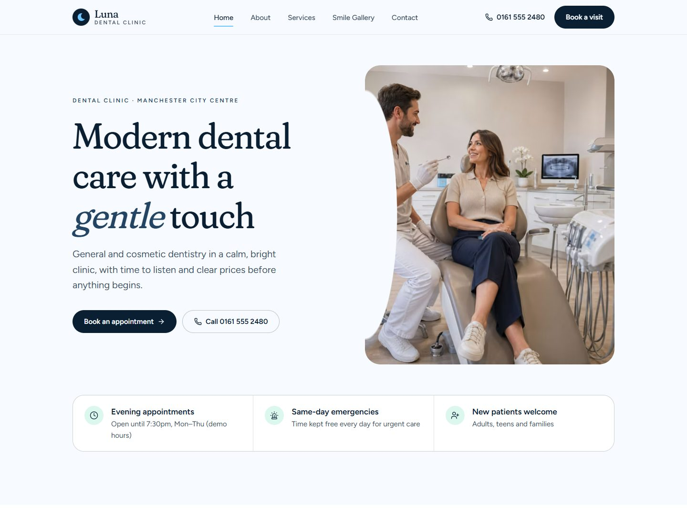
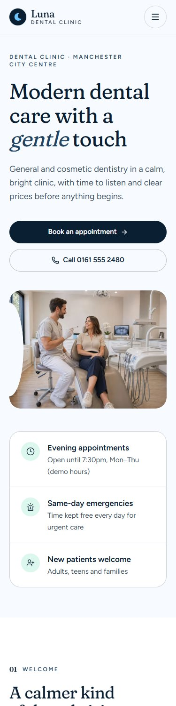

# Luna Dental Clinic

**Modern dental care with a gentle touch.**
A five-page website for a fictional general and cosmetic dental clinic in Manchester, built for MX AI Academy, Challenge 1.

> Luna Dental Clinic is not a real business. Team names, prices, opening hours and testimonials are fictional demo content and are labelled as such on the site.

<p>
  
  
</p>

## Pages

| Route | What it contains |
| --- | --- |
| `/` | Hero with two calls to action and three trust facts, intro, six services, why choose us, demo testimonials, booking CTA |
| `/about` | Fictional story, team, values, clinic atmosphere |
| `/services` | Six treatments with description, what is included, typical time and starting price |
| `/smile-gallery` | Smiles, clinic, treatment rooms, equipment and team (no before-and-after photos) |
| `/contact` | Address, phone, email, opening hours, map block, booking form with validation |
| `/credits` | Unsplash photographer credits |

## Design

- **Type:** Fraunces (soft serif, headings) and Figtree (body), loaded with `next/font`
- **Colours:** Deep Navy `#0B1F33`, Soft Sky Blue `#6EC6FF`, Ice White `#F7FBFF`, Cool Grey `#E5EAF0`, Mint Green `#7DE2C3`. Sky and Mint are used for fills and accents, or on Navy, so all text passes WCAG AA contrast.
- **Signature detail:** a soft crescent ("luna") shape in the logo, the hero photo edge, section dividers and the booking banner.
- **Motion:** CSS-only fade on scroll (no JavaScript), switched off for `prefers-reduced-motion`.

## Tech

- Next.js 16 (App Router, TypeScript), Tailwind CSS 4, `lucide-react` icons
- `next/image` with Unsplash `remotePatterns`, AVIF/WebP, only the hero image preloaded
- Every page is statically pre-rendered
- SEO: per-page metadata, Open Graph image, canonical URLs, `sitemap.xml`, `robots.txt`
- Security headers set in `next.config.ts`

## Run locally

```bash
npm install
npm run dev
```

Open http://localhost:3000.

Production build:

```bash
npm run build
npm start
```

Set `NEXT_PUBLIC_SITE_URL` to the live address (for example `https://your-site.vercel.app`) so canonical URLs, the sitemap and share images use the right domain.

## Quality

Lighthouse (mobile, production build): Performance 93 to 96, Accessibility 100, Best Practices 100, SEO 100 on all five pages.

## Credits

Photos from [Unsplash](https://unsplash.com) photographers, listed on the `/credits` page. Icons by [Lucide](https://lucide.dev).
